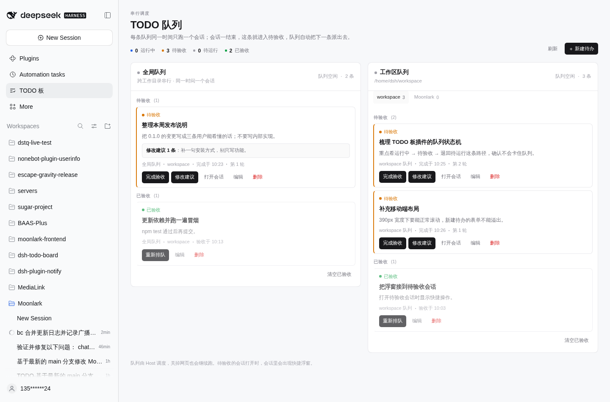
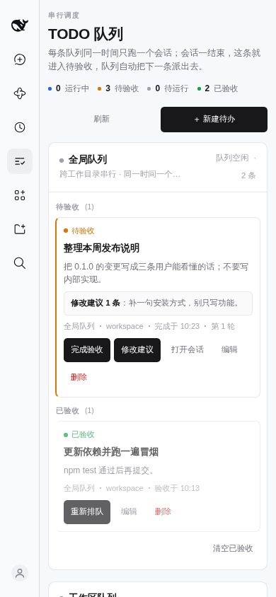
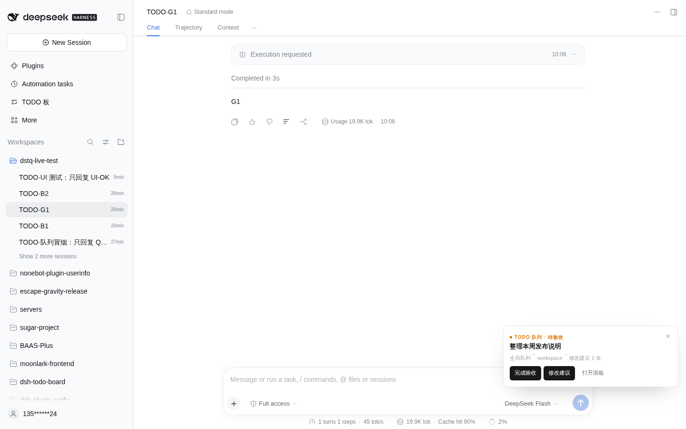

# dsh-todo-queue

**DeepSeek Harness 的串行 TODO 队列板：一次只让一个会话跑一条队列，跑完自动进入待验收，队列空闲后自己派下一条。**

**A serial TODO queue for DeepSeek Harness: one session per queue, automatic dispatch when idle, and a review step the user can send back with change requests.**

[](LICENSE)
[](package.json)
[](package.json)



---

## 它解决什么 / Why

普通待办板容易变成「一次性把十件事塞给 AI」：结果每件都做一半，你还得逐个盯着。
这个插件把「执行」变成一条**串行队列**：

- **每个队列同时只有一个会话在运行。** 全局队列跨工作目录串行；工作区队列按目录各一条，互不阻塞。
- **队列空闲时自动派发下一条。** 不用你点「继续」，也不用打开网页。
- **会话结束就进入待验收。** 打开这个会话时，右下角会出现快捷浮窗：完成验收，或写修改建议退回待运行。
- **退回时建议会进下一轮提示词。** 同一条待办会尽量复用原来的会话，保留上下文。
- **控制面板是一个独立主页面。** 侧栏「TODO 板」进入，PC / 移动端自适应；它只负责看和改，调度在 Host 上跑。

## 功能一览 / What you get

| 能力 | 一句话 |
| --- | --- |
| 串行队列 | 全局 1 条 + 每个工作目录各 1 条；每条队列最多一个运行中的会话 |
| 自动派发 | 队列空闲时自动开新会话（或复用该待办的旧会话）执行下一条 |
| 待验收 | 会话本轮结束后自动进入「待验收」，不会直接算完成 |
| 修改建议 | 在面板或浮窗里写建议 → 退回待运行 → 下次派发带着建议一起发 |
| 独立页面 | 侧栏入口 + 占满主区域的响应式页面，不是浮窗 |
| 移动端 | 390px 宽度下可滚动、表单不溢出、从侧栏进入时自动收起抽屉 |
| 会话浮窗 | 打开待验收会话时显示快捷操作：完成验收 / 修改建议 / 打开面板 |
| 不依赖网页 | Host 端调度器持有队列；关掉浏览器标签也继续派发 |
| 认得出「别的会话」 | 同一目录里有**不是队列当前正在驱动**的会话在跑时（你的聊天、别的插件），队列等它结束再派发 |
| 模型工具 | `todo_queue`：list / add / done / note，写操作走 DSH 原生审批框 |
| 极简界面 | 白底、细线、一个状态点；深色主题跟随 DSH |

## 安装 / Install

从 GitHub 安装：

```sh
dsh plugin --profile web add github:This-is-XiaoDeng/dsh-todo-queue
```

本地开发（link 模式，改代码后由 profile 的 HMR 重载）：

```sh
dsh plugin --profile web add link:/home/dsh/workspace/dsh-todo-queue
```

安装后如果 profile 没有启用 live 重载，重启一次 `dsh web`。卸载：

```sh
dsh plugin --profile web remove dsh-todo-queue
```

> **从旧版 `dsh-todo-board` 迁移？** 两者是不同包，同一份 profile 里请只保留一个：
> `dsh plugin --profile web remove dsh-todo-board` 再装本插件。旧板的数据仍留在
> `${DSH_HOME}/todo-board/board.json`，本插件不会覆盖它；需要的话可以手工把标题 / 备注搬过来。

## 工作原理 / How it works

### 两条队列 / Two queue families

| 绑定 | 队列键 | 行为 |
| --- | --- | --- |
| 全局 | `global` | 所有绑到全局的待办共用一条队列，跨工作目录串行 |
| 工作区 | `workspace:<绝对路径>` | 每个工作目录一条队列；不同目录可以同时各跑一个会话 |

每条队列的状态是**推导**出来的，不是另存一份：

- 队列里有 `running` 的待办 → 忙；
- 没有 → 取下一条 `pending`，按板子从上到下的顺序派发；
- 派发失败 → 该条变 `failed`，队列继续尝试后面的（不会整条队列卡死）。

### 一条待办的生命周期 / Row lifecycle

```
pending ──派发──▶ running ──本轮结束 / AI 标记 done──▶ review
   ▲                                                      │
   │                      用户写修改建议并退回             │
   └──────────────────────────────────────────────────────┘
                                                          │
                                             用户完成验收 ▼
                                                       accepted
```

- **pending**：在队列里排队，队列空闲就自动开始。
- **running**：已创建/复用会话并发出提示词。
- **review**：本轮已结束，等用户验收。打开对应会话会看到浮窗。
- **accepted**：用户已验收，留在「已验收」区，可重新排队或删除。
- **failed**：派发或启动失败，错误写在卡片上，可重试。

### 一个目录只有一个会话 / One directory, one session

串行不能只对着插件自己的行：你在同一个目录里开着自己的会话、别的插件在跑、
或者你回到某条旧待办的会话里继续聊天，动的都是同一份文件。所以派发前 Host 会看一遍
live agent 表：

- 目标目录里**除了队列自己正在驱动的那一个会话**，任何还在 `running` 的会话都算占用；
- 被占用的行保持 `pending`，卡片上写「等待 N 个其他会话空闲」，面板队列头显示「等待其他会话」；
- 占用它的会话一 `idle`（或销毁），`agent/status` 立刻触发一次调度，队列自己接着跑，不用你点。

这是「等待」而不是「报错」：队列不会因为你在同一目录聊天就把待办判成失败。
全局队列和某条工作区队列同时派发到别的目录时仍然并行——那是插件自己派发的会话，按设计算各自队列的一部分。

### 为什么关掉网页也能跑 / Host-side scheduling

调度器、队列状态和派发逻辑都在 `lib/index.js`（Host 半边）。浏览器只通过
`/dsh-todo-queue/api` 读写快照，不参与派发。Host 用 `agent/turn-stopping` 和
`agent/status` 判断一轮是否结束，然后释放队列、派发下一条。

### 提交建议后会发生什么 / Send-back semantics

`review → pending` 时会把建议追加到 `feedback`。下一次派发：

1. 如果该待办原来的会话仍然活着、且工作目录没变，就把新提示词 `followup` 进去，保留上下文；
2. 否则新开一个会话，提示词里带上全部历史建议。

提示词里会明确写：只做这一条、不要向用户确认、完成后直接结束本轮（插件会自动标待验收）。

## 界面 / UI

### 独立主页面



- 左侧「TODO 板」→ 主区域打开独立页面。
- 顶部是统计（运行中 / 待验收 / 待运行 / 已验收），不是弹窗。
- 左列全局队列，右列工作区队列；工作区有多个时用标签切换。
- 卡片按状态分区：运行中 / 待验收 / 排队中 / 异常 / 已验收。
- 新建 / 编辑待办时，「运行目录」是**下拉选择**：当前会话目录 + DSH 已知的工作区；要换新目录选「其他目录（手动输入）」。
- 移动端会把两列堆叠，页面自身成为滚动容器；从抽屉进入时自动收起侧栏。

### 待验收浮窗



打开一条 `review` 会话时，右下角出现浮窗：

- **完成验收**：直接 `accepted`，浮窗消失；
- **修改建议**：展开输入框 → **退回待运行**；
- **打开面板**：跳到 TODO 板页面。

浮窗只在该会话确实绑定了一条待验收待办时出现；打开其他会话或面板时不会出现。

## 模型工具 / Model tool

`todo_queue`：

| action | 说明 | 审批 |
| --- | --- | --- |
| `list` | 查看全部队列和状态 | 否 |
| `add` | 新增待办（默认当前会话工作目录） | 是 |
| `done` | 把当前会话正在跑的待办标为待验收 | 否 |
| `note` | 追加/修改备注 | 是 |

写操作在 `tools/pre-execute` 层拦截，走 DSH 原生审批框；被拒绝就停手。
`done` 不审批：它是执行中的会话自己的完成信号，插件本来也会在本轮结束时自动标待验收。

## 数据与接口 / Data & API

- 板文件：`${DSH_HOME}/todo-queue/board.json`（原子写入，损坏时备份为 `.corrupt-<ts>` 后空板启动）。
- 路由：`GET /dsh-todo-queue/api` 返回快照；`GET ?session=<id>` 额外返回该会话绑定的待办（浮窗用）。
- `POST` 动作：`create` / `patch` / `remove` / `accept` / `sendBack` / `run` / `move` / `clearAccepted`。
- 路由经过与 DSH 相同的 Host/Origin 信任围栏；没有浏览器凭据的本机进程不能写板。

## 开发 / Development

```sh
npm test            # node tools/smoke.mjs：队列、串行、两条队列、退回、持久化、工具、审批
npm run check       # node --check 两半
```

本地验证顺序建议：

1. `dsh plugin --profile web add link:<repo>`（或改 profile package.json 后热重载）；
2. 在面板建一条会很快结束的待办，例如「只回复 OK」；
3. 观察它自动派发 → 待验收；
4. 打开该会话，确认浮窗出现，试一次「修改建议 → 退回待运行」。

## 限制 / Current limits

- 还没有定时执行、图片附件、拖动排序；需要这些时先看旧板 `dsh-todo-board` 的实现再决定是否加回来。
- 「工作区」以绝对路径为准；目录被删后，该队列会停在错误上，需要改目录或删除待办。
- 会话是否「复用」取决于它是否还在 Host 的 live agent 表里；进程重启后旧会话不存在，会开新会话并在提示词里保留建议，但不保留旧会话的完整上下文。
- 队列只按**目录**判断占用：同目录里正在跑、且不是队列当前正在驱动的那个会话会让队列等待；父目录、子目录里的会话不算（工作区队列本来就是按绝对路径分键）。

## License

MIT
